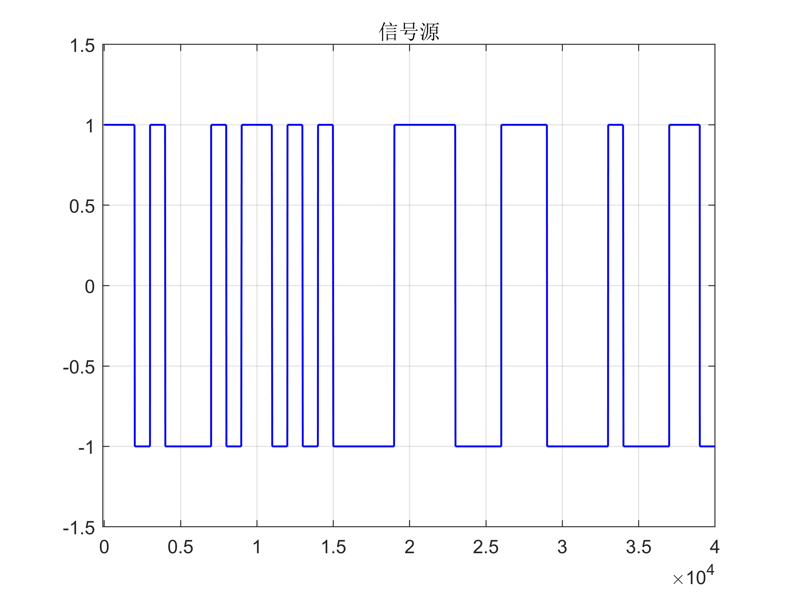
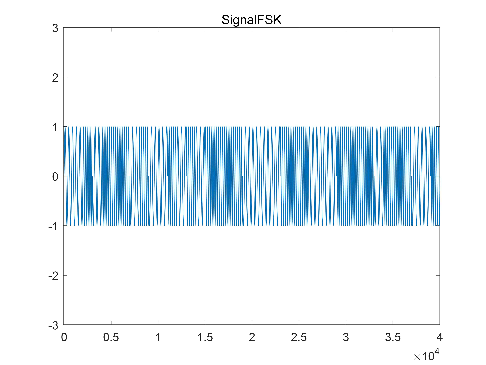
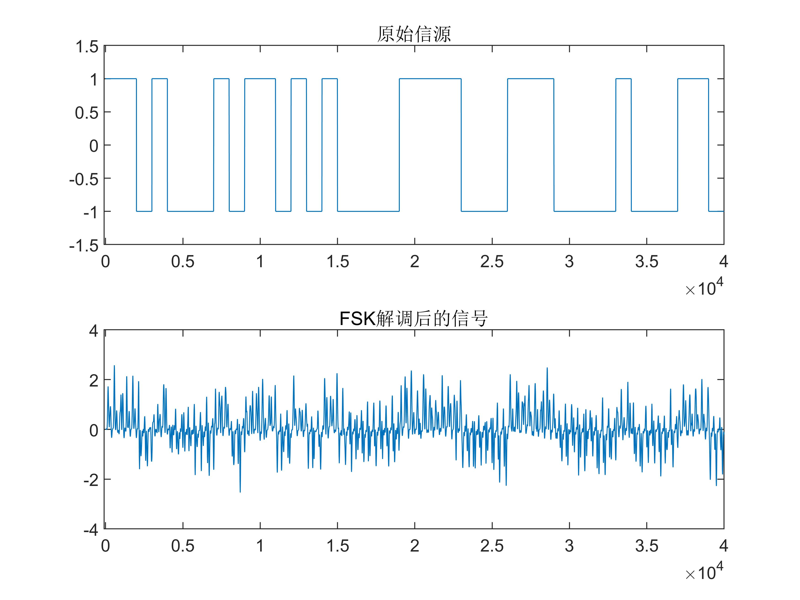
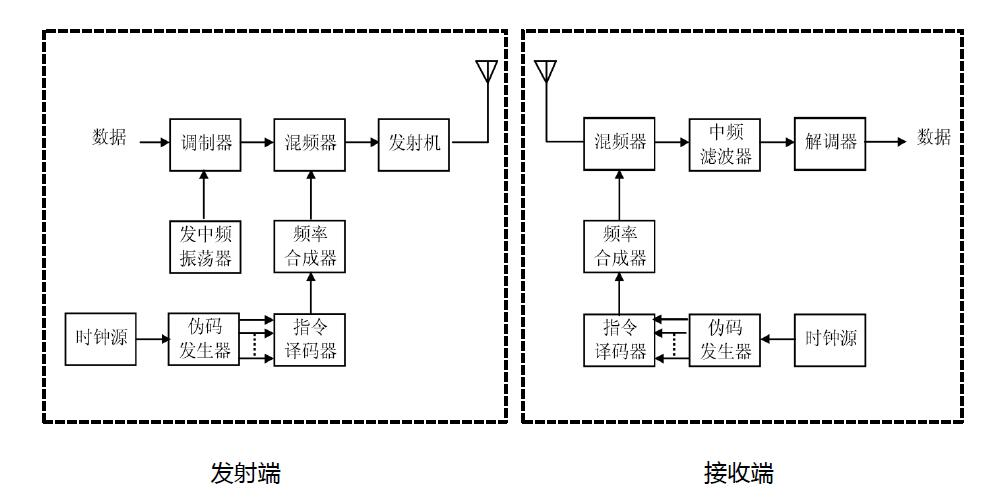
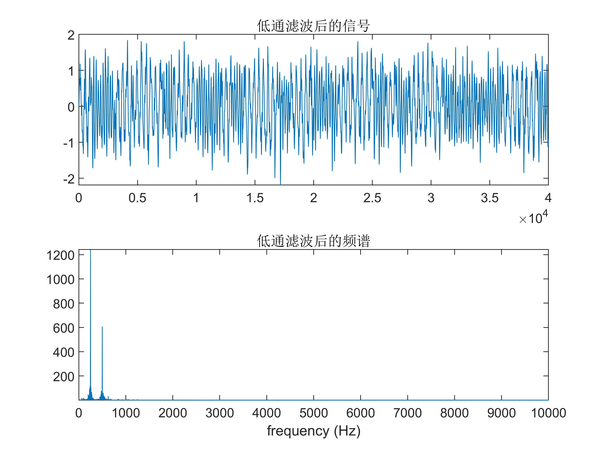
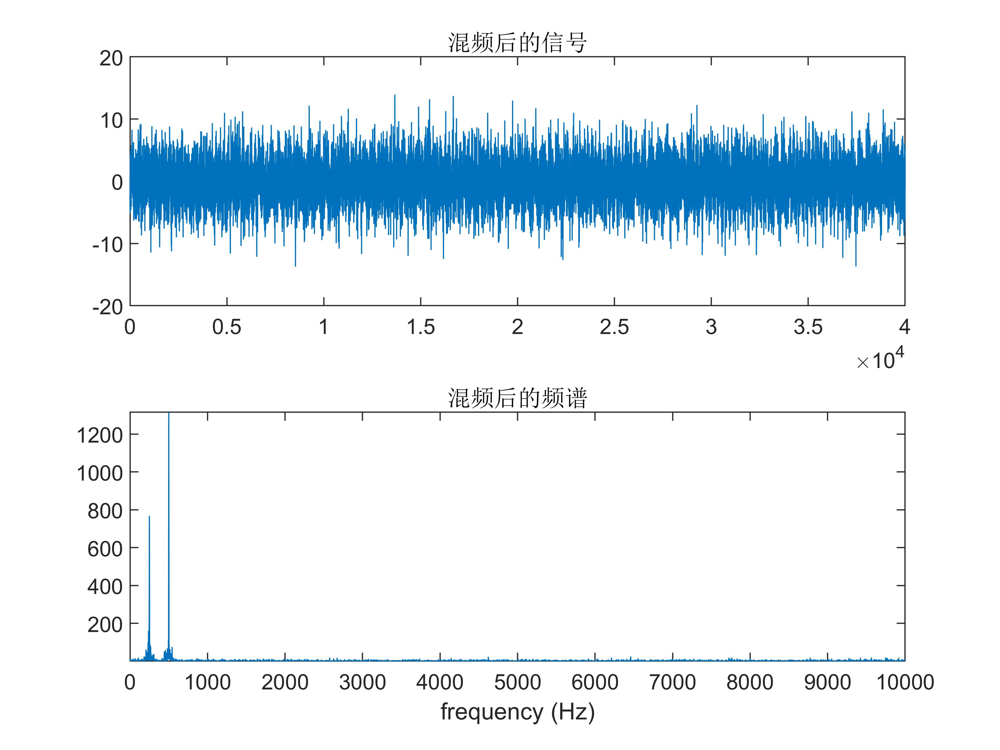
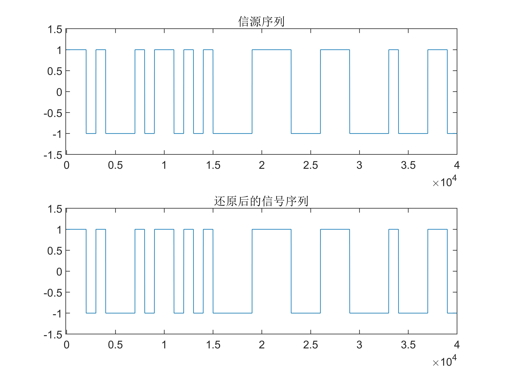
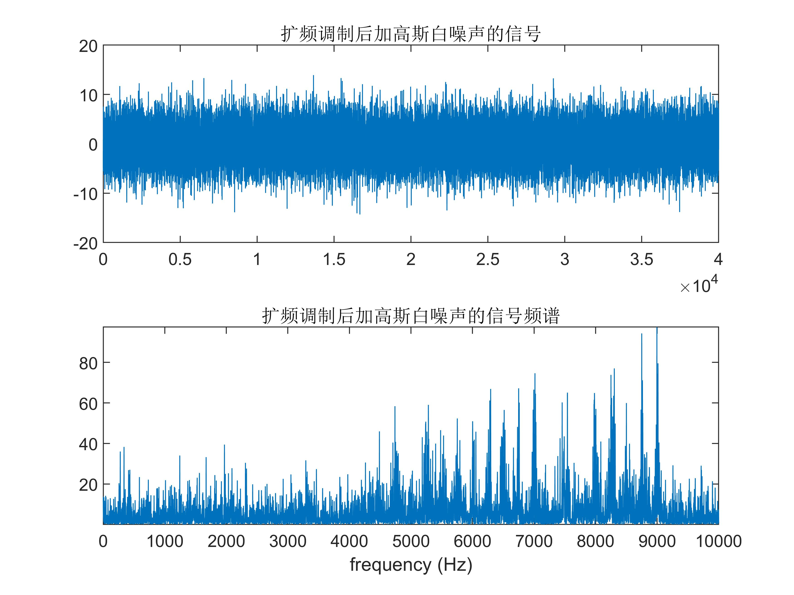
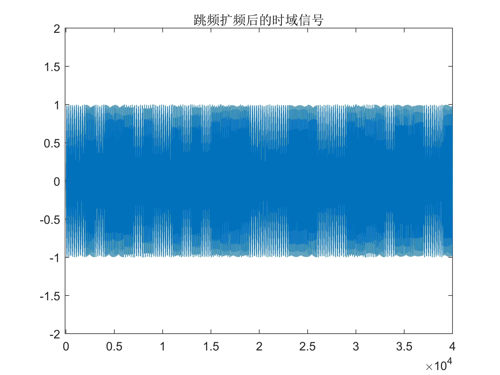
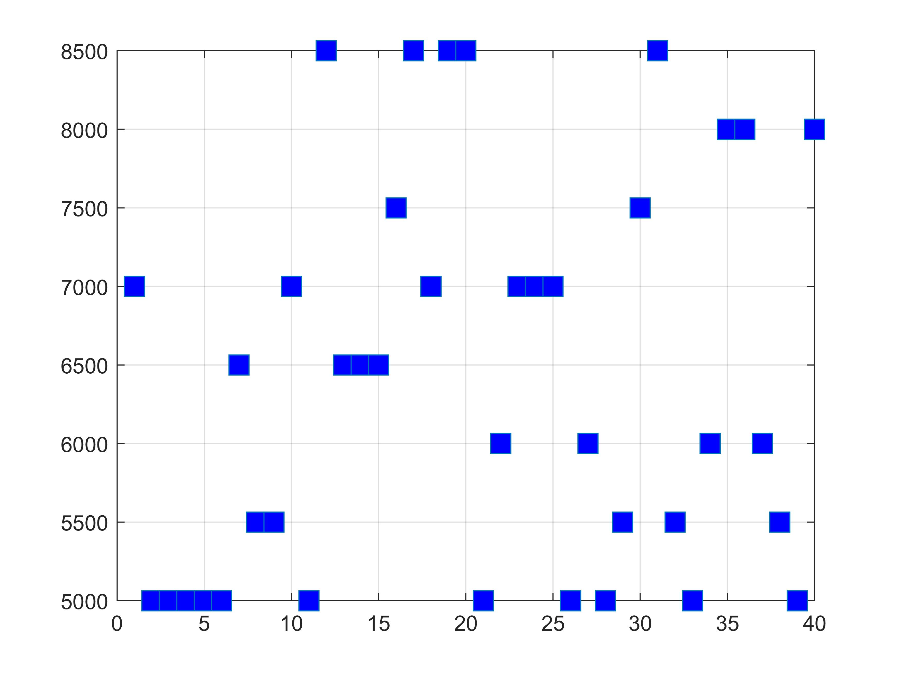

# Simulation and Analysis of Frequency Hopping Spread Spectrum Communication System in Matlab

\n        \n  
\n        \n  
\n        \n  
\n        \n  
\n        \n  
\n        \n  
\n        \n  
\n        \n  
\n        \n  
\n        \n  

## Images

<!-- PAYMENT_BLOCK -->

## Get this dataset

- Payment link (Stripe): [Buy now](https://buy.stripe.com/3cs8yP7sY87d0vu9AB)
- Payment QR code: 

<!-- /PAYMENT_BLOCK -->
